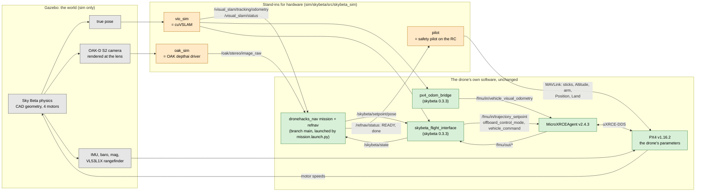

# Dronehacks-2026 — `sim`: the drone's stack in a Gazebo course sim

| Branch | Holds |
|---|---|
| `main` | the flight code: what the drone flies (`git push drone main`) |
| `sim` | this simulator. No flight code of its own: it flies a branch of `main` |

```sh
./fly-sim.sh                    # fly `main` (what the drone flies)
./fly-sim.sh --code <ref|dir>   # fly another branch, commit, or a folder with a dronehacks_nav package
./fly-sim.sh --mode <N>         # fly modes.json mode N (default: the code's active mode)
./fly-sim.sh --headless         # no Gazebo window (faster)
./fly-sim.sh stop               # stop the sim and its VM
```

Needs Docker CLI and Colima on the Mac. The first run builds the images (~45 min, once); after that
a run starts in a minute or two. It prints where everything is: Gazebo
(`http://127.0.0.1:8082/vnc.html?autoconnect=1&resize=scale`), the team's camera page
(`http://127.0.0.1:8080/`), Foxglove (`ws://127.0.0.1:8765`), the logs and the bag. Ctrl-C stops it.

## From the sim to the drone: a new policy

A policy is a branch off `main`: refnav changes, a new `modes.json` mode, or both. Nothing is copied
between branches by hand; the sim flies the branch itself and `promote.sh` merges it.

```sh
git switch -c policy/<name> main        # in a checkout of main (e.g. git worktree add ../main main)
#   ...edit refnav/, add a mode to modes.json, run python3 -m pytest -q tests, commit
./fly-sim.sh --code policy/<name> --mode <N>     # from this sim checkout; repeat until it ends "complete"
./promote.sh policy/<name>                        # tests + a completed sim run of that exact commit -> merged into main
git push origin main && git push drone main      # then fly it for real
```

Each run writes `sim/artifacts/skybeta/<run>/result.json` (branch, commit, mode, how the mission
ended). `promote.sh` refuses unless the branch contains the current `main`, its tests pass, and a
run of exactly its current commit on this machine ended `complete`; a new commit needs a new run.
A sim pass is necessary, not sufficient: the sim's VIO and depth are perfect (below).

The course in the sim is the real one: walls from the 2026-11-06 point scan (`sim/scan/README.md`).

## How it works, and why it matches the drone

Green is the drone's own software, run unchanged. Orange replaces the hardware a laptop does not
have, publishing exactly the topics the hardware publishes on the drone. Grey is the simulated world.



The parity comes from the topic boundary. Everything green talks only to topics, and in the sim
those topics carry the same names, types, frames and units as on the drone. The stand-ins are the
only new code, and each one replaces exactly one piece of hardware:

| On the drone | In the sim | Same? |
|---|---|---|
| `dronehacks_nav` + `refnav` from `main`, `mission.launch.py`, camera page, map, bag | the same code, exported from git; only `use_sim_time: true` is set | same code |
| `skybeta_flight_interface`, `px4_odom_bridge` (skybeta 0.3.3) | the same files (`sim/skybeta/src`) | same code |
| MicroXRCEAgent v2.4.3, px4_msgs release/1.16 | the same versions; UDP instead of the serial cable | same |
| PX4 v1.16.2 on the Pixhawk 6C | PX4 v1.16.2 SITL with the drone's parameters (`sim/skybeta/px4_params.py`) | same firmware |
| Sky Beta airframe | `sim/models/skybeta`: geometry from the organisers' CAD; mass, inertia and thrust estimated (`sim/skybeta/AIRFRAME.md`) | close |
| OAK-D S2 depth, `/oak/stereo/image_raw` | Gazebo depth at the OAK's position and field of view, converted to the same message | perfect depth |
| cuVSLAM, `/visual_slam/tracking/odometry` | Gazebo's true pose, re-zeroed where it starts, as cuVSLAM does | no drift, no delay |
| Safety pilot | `pilot`: READY, Altitude, arm, Position, then Land when the mission ends | scripted |
| ROS 2 Humble | ROS 2 Jazzy (the release that pairs with Gazebo Harmonic) | same Python code |

So a sim run tests the mission logic, the flight interface, PX4's control and estimator, and the
timing between them. It does not test cuVSLAM or real stereo depth: those are perfect here.

## Comparing with the drone

The drone's `fly.sh` (on `main`) and `fly-sim.sh` record the same topics, so two bags line up:

```sh
python3 -m pip install rosbags numpy matplotlib    # once
python3 sim/skybeta/compare.py DRONE_BAG SIM_BAG    # report.md + plots, aligned at Offboard
```

## Files

| Path | What |
|---|---|
| `fly-sim.sh` | the one command |
| `promote.sh` | merge a policy branch into `main` once it has passed in the sim |
| `sim/scan/` | the point scan of the real course and the script that turns it into the sim's walls and the course route |
| `sim/skybeta/` | the drone stack in the sim: stand-ins, PX4 parameters, airframe, comparison (`sim/skybeta/README.md`) |
| `sim/models/skybeta` | the Sky Beta (generated by `sim/skybeta/make_model.py`) |
| `sim/` (rest) | the course world and the Gazebo + PX4 SITL images, from [machmoon/dronehacks-sim](https://github.com/machmoon/dronehacks-sim) |
| `latex/`, `shared-context/` | write-ups and team context |
