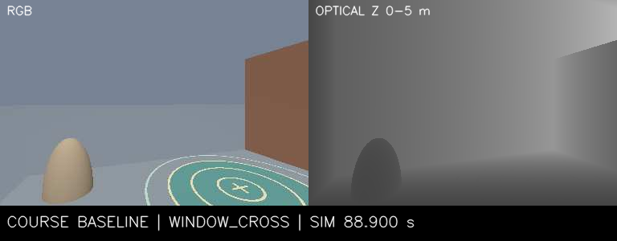

# dronehacks-sim

Gazebo Harmonic and PX4 SITL for the DroneHacks window route. The current branch uses forward RGB-D registration against the supplied course survey, downward ToF, and PX4 EKF2. It has no artificial AprilTags and does not use simulator pose for navigation. A separate observer records truth and contacts for offline scoring. The public repository is [machmoon/dronehacks-sim](https://github.com/machmoon/dronehacks-sim).

Course-08 completed the marker-free waypoint baseline: 15/15 waypoints, PX4 landing and disarm after 83.000 simulated seconds, and independent truth scoring of the modeled multipart x500 envelope through the window and onto the pad. The conservative CAD-proxy score reports 0.106299 m minimum window aperture clearance with 15 mm inflation and 0.313969 m horizontal landing-pad envelope clearance. The navigation-source audit found no truth-topic publisher and no artificial landmark models; truth was recorded only for offline scoring. Contact-topic coverage was partial, so this does not establish zero physical collisions. This is a baseline controller run, not a learned-policy result or real-aircraft validation.



[Watch the course-08 RGB/depth replay](docs/media/window-baseline.mp4) (100.28 seconds; rendered from recorded simulation-time frames). The learned-policy flight is currently running as policy-01 and remains unverified until it is scored. Read the [flight evidence, limitations, and commands](docs/markerfree-rgbd.md) before treating any run as a success. Compact machine-readable results and provenance are in [markerfree-results.json](docs/markerfree-results.json).

## Run the current experiment

The Mac setup uses Docker, Colima, the existing `dronehacks-px4:local` image, and a separate Compose project. Once the image is available, start the dedicated simulator and viewer in separate terminals:

```sh
./runtime/run-markerfree.sh
python3 -m web.server
```

Open [http://127.0.0.1:8083](http://127.0.0.1:8083). Starting the simulator does not arm the vehicle. The [experiment runbook](docs/markerfree-rgbd.md) gives the explicit hover, course, learned-policy and independent-scoring commands. The viewer follows `artifacts/markerfree/current` and labels whether the recorded run used the waypoint baseline or a frozen learned checkpoint.

## Bounded Mac learning run

The [learning experiment](learning/README.md) trains a small depth policy with supervised imitation and student rollouts. The `x500-transfer` profile uses the centered route, multipart x500 envelope, 0.34 m forward camera, and a velocity-response range measured against PX4. Training uses analytic depth and dynamics; it does not run Gazebo or establish real-camera transfer.

With a native Python environment containing NumPy and PyTorch:

```sh
python3 runtime/train_overnight.py --python /path/to/venv/bin/python --seconds 18000 -- \
  --profile x500-transfer --device mps --seed 44 --eval-interval 300
```

Use the remaining wall-time budget when resuming an interrupted experiment. The supervisor prevents duplicate jobs, caps runtime, and keeps the Mac awake. Results, source hashes and checkpoints stay in `artifacts/learning/`. Keep the Mac plugged in with its lid open. To stop and save:

```sh
python3 runtime/train_overnight.py --stop
```

See the [competition references and SAND-O status](docs/competition-reuse.md) for the projects investigated and their limits. The local SANDO checkout is a reference; its ROS 2/Gurobi planner is not integrated into this Mac run.

The [OAK metric-depth handoff](docs/oak-depth-handoff.md) summarizes the pinned physical camera driver, verified depth/confidence semantics, bandwidth constraints, and passive capture requirements. The current course-08 replay uses simulated RGB-D footage only.

## Historical marker-assisted diagnostic

The following explicit opt-in recreates the earlier artificial-marker fixture. Its completed flights verify the PX4 external-vision connection, not navigation on the actual course:

```sh
SIM_TEST_MARKERS=1 ./runtime/replay-px4.sh course
SIM_TEST_MARKERS=1 SIM_GUI=0 ./runtime/replay-px4.sh hover --blackout-after 18
```

See [docs/px4-camera.md](docs/px4-camera.md) for the navigation architecture, verified results, and limitations. See [docs/vision.md](docs/vision.md) for camera calibration and marker-map details.

## Historical PX4 diagnostic results and limits

Verified runs include a hover-height acquisition in 30.040 simulated seconds and a GUI run completing all 15 waypoints in 94.696 simulated seconds at 640×480 camera resolution. The camera-loss check stopped forwarding pose measurements at 18 simulated seconds while the vehicle was climbing at about 0.5 m; the route aborted 0.568 simulated seconds later, and PX4 reported landing and disarming. These runs confirm external-vision position, height, and yaw fusion with GNSS, barometer, range, and optical-flow fusion inactive. Waypoint completion uses PX4 estimated position; collisions and swept clearance were not scored. The native 480×360 camera run also completed all 15 waypoints in 96.376 simulated seconds. See [docs/px4-results.json](docs/px4-results.json) for the recorded runs.

This is a camera-loop baseline, not a complete sim-to-real validation. It adds a downward-facing monocular camera and surveyed AprilTag markers to the Gazebo course. The physical aircraft uses a forward-facing OAK-D-S2 stereo camera with cuVSLAM visual-inertial odometry on Jetson. The stock x500 is not the physical airframe. These runs do not validate the real camera stack, real flight, collision safety, or course clearance.

The camera runs at 30 Hz of simulation time. A 650-response MAVLink time-sync warmup at 50 Hz completes before arming. Software rendering may advance simulation slower than wall time, so use simulation timestamps when comparing camera and vehicle data. The Python course-control core is shared, but this SITL path uses MAVLink and PX4 position feedback; the physical cuVSLAM path uses a ROS 2 bridge.

## Gazebo ground-truth comparison mode

The older non-PX4 demo uses the Open Robotics X3 v4 quadrotor and follows the course from Gazebo ground-truth odometry. To run it, start the simulation with `./runtime/run-mac.sh`, then launch the same viewer with `./web/run.sh`. It also uses [http://localhost:8081](http://localhost:8081), with the Gazebo desktop at [http://localhost:8080/vnc.html?autoconnect=1&resize=scale](http://localhost:8080/vnc.html?autoconnect=1&resize=scale).

That separate baseline completed all 15 waypoints in 61.780 simulated seconds with zero obstacle contacts and 0.0905 m clearance at the padded window check. The optional tuned window profile completed in 47.736 simulated seconds with zero contacts and 0.0906 m clearance. These ground-truth results are not directly comparable to PX4 camera runs: vehicle models, navigation sources, and scoring differ. Setting speed scale to 1 on the default ground-truth route failed the conservative window-clearance check. See [docs/results.json](docs/results.json) for details. Isaac Sim and ROS 2 are not required for this comparison demo. Linux Docker Compose may work, but the setup has been tested on Apple Silicon macOS with Colima.
