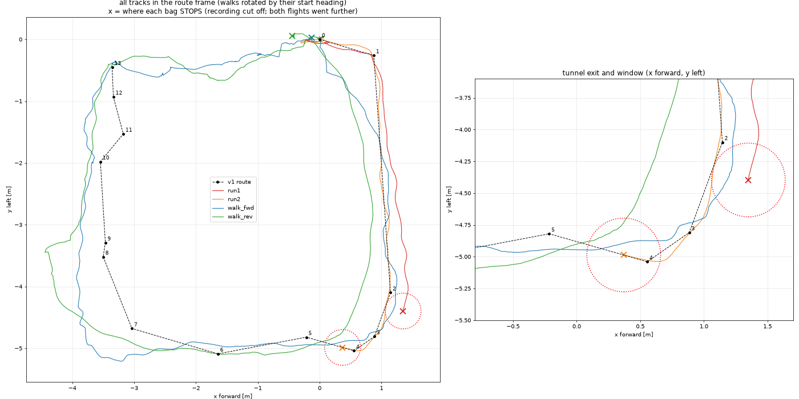
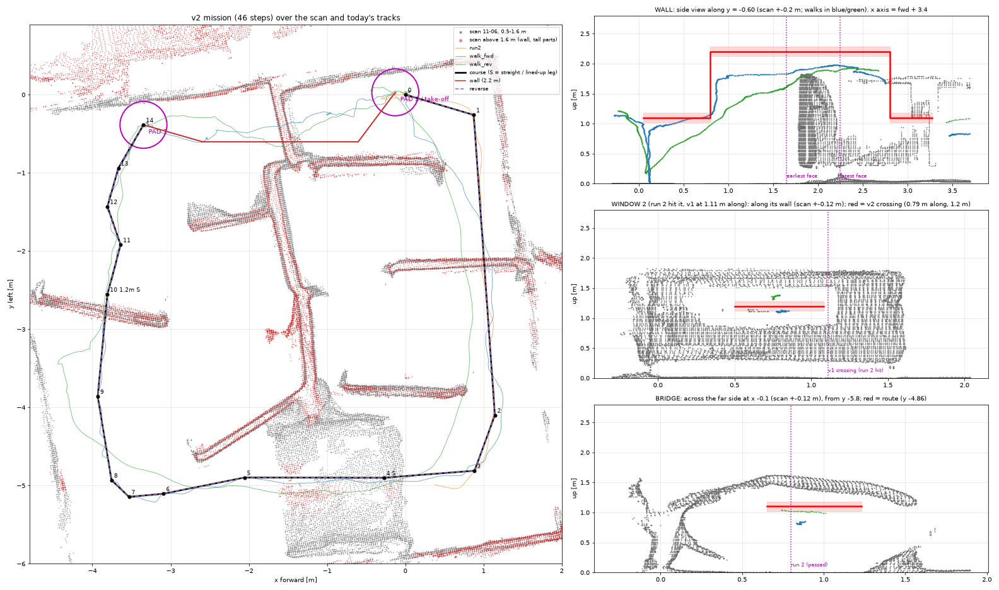
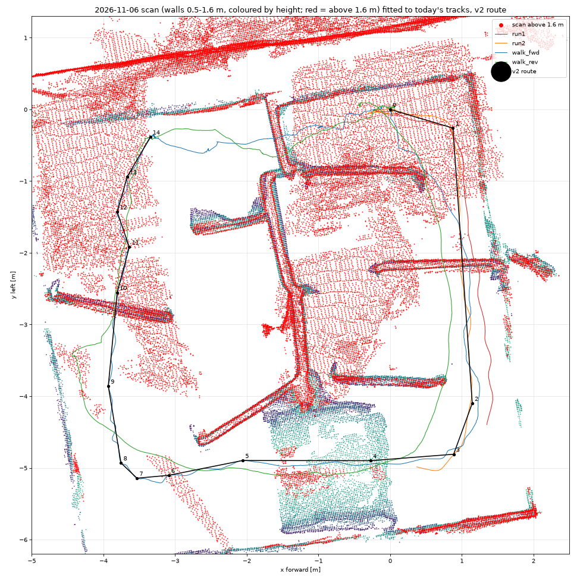

# dronehacks_nav — `main`, the code the drone flies

`main` is the team's mission as it runs on the skybeta drone (`skybeta-02`, Jetson Orin Nano,
PX4 v1.16.2). The simulator lives on `sim`; new policies come from it through `promote.sh` (`SYSTEM.md` §10). **`SYSTEM.md` explains how the whole system works**; this
file is the quick start.

> **Before flying, read `PICKUP.md`:** with depth on, VIO reaches PX4 ~290 ms late and PX4 has no
> position. That is the next thing to fix.

## What flies now: `box_route_v2` (2026-11-08)

On competition day the drone flies **`drone-pkgs/box_route_v2`**, a waypoint mission over the full
course. It's built from our own flight and walkthrough data. **`drone-pkgs/box_route`** is v1, the
fallback. Both are byte-for-byte the copies on the Jetson (`~/team_ws/src/`), and
`/etc/skybeta/drone.env` (`COMPETITOR_PKG=`) picks the one the stack starts. Everything it flies is
in one file, `drone-pkgs/box_route_v2/config/route.yaml`. The drone re-reads it while disarmed, so
there's no rebuild.

**How the route was made.** We flew the course twice, then carried the drone through it forwards and
backwards. Every track went into one frame: the walkthroughs were rotated by their start heading, and
the two independent walks then agree on the landing pad to 4 cm. A 2026-11-06 Scaniverse scan of the
course was registered onto a depth map from an earlier walk (median 2.5 cm), which gives wall and
window heights. Every leg of the route is within 9 cm of a path the drone has physically flown or
been carried along.



**What the data showed, and what v2 changes:**
- **Run 1** hit the tunnel-exit wall because v1 rotated the whole route to the nose heading at
  Offboard start. That heading was 4° that day, which moved the route 0.3 m sideways at the tunnel
  exit. v2 keeps the route fixed to the course (`rotate_to_heading: false`).
- **Run 2** went under the bridge and hit **window 2**. v1 crossed it 0.32 m to the drone's right of
  the opening's centre. v2 crosses at the centre, which both walkthroughs and the scan agree on, at
  1.2 m. Window legs are flown dead straight (`straight: true`, lined up within 5°).
- The back half of v1 was 0.23–0.64 m inside where we walked today. v2 follows today's walk.
- Both flight bags were cut off by the power going, which lost 30 s of run 2. v2's `fly.sh` now
  splits the bag every 10 s and flushes to disk every 2 s.



**The full mission:** course → hover over pad 1 → over the 1.9 m wall at 2.2 m, staying right of
the ladder → hover over pad 2 → the whole thing in reverse → land. Each section has its own `enabled`
in route.yaml, and the drone lands at the last one enabled. PX4 holds height on the rangefinder
(`EKF2_HGT_REF = 2`), which sees the wall top. So in the wall section our checks use VIO height, an
outer loop on VIO trims the height if PX4 gets fooled, and a VIO fault there means hold, not descend.
`drone-pkgs/box_route_v2/test/sim_offline.py` flies the real mission code without ROS, including the
worst-case rangefinder effect.



The analysis scripts (bag reader, alignment, scan fit, plots) are in `drone-logs/analysis/`. The bags
themselves aren't in git.

| Path | What it is |
|---|---|
| `refnav/core.py`, `refnav/depth.py` | The mission's flight logic and depth processing. The mission logic; the sim flies this exact file (below) |
| `dronehacks_nav/skybeta_node.py` | The ROS shell for the drone: cuVSLAM odometry + `/skybeta/state` in, `/skybeta/setpoint/pose` out |
| `dronehacks_nav/frames.py` | ENU/FLU (skybeta) ↔ NED/FRD (refnav.core) conversions |
| `dronehacks_nav/motion_check.py` | Freeze if commanded motion does not show up in odometry, or VIO height disagrees with the rangefinder |
| `dronehacks_nav/mapping.py`, `map_node.py` | Voxel occupancy map from depth + pose: `/map/occupied`, `/map/image` |
| `dronehacks_nav/camera_web.py` | Camera, depth and map as a web page on port 8080 |
| `launch/mission.launch.py` | `skybeta_flight_interface` + the mission node |
| `config/drone.yaml` | ROS parameters of the mission node |
| `modes.json`, `apply_mode.py`, `route.json` | What to fly: pick a mode in `modes.json`, run `python3 apply_mode.py`, which writes `route.json` |
| `scripts/fly.sh` | Start/stop a flight session on the drone |
| `skybeta_overrides/` | Team image that turns on the OAK's stereo depth |
| `tests/` | `python3 -m pytest -q tests`: mission, frames, motion check, map; no ROS needed |

## How it flies on skybeta

The drone's stack (`~/skybeta`, owned by the organisers) already runs the
OAK-D, cuVSLAM, the vision bridge into PX4, and `skybeta_flight_interface`,
which owns everything on `/fmu/in/*`. Read `~/skybeta/docs/competitor_guide.md`
on the drone. In short:

- **We never arm, never change mode, never land.** The safety pilot arms on
  Altitude, then switches to Position; if this node is streaming setpoints the
  flight interface enters Offboard and the mission takes off.
- The node streams only once the mission is ready (`READY` in the log), so
  arming before that leaves the pilot in Position.
- When the mission ends or wants to land it **holds position and asks the pilot
  to take over and land**: skybeta has no land command, and altitude is floored
  at `min_altitude_m` (0.3 m).
- Altitude is clamped to 0.3–3.0 m above the startup pose. **There is no
  horizontal geofence**: size the route to the space.

**Depth:** `refnav.core` refuses to fly without depth (it never translates without
observed free space). skybeta ships no depth image, so the team image below turns
on the OAK's own stereo depth, `/oak/stereo/image_raw`.

## Deploying: the stack starts our code at power-up

Exactly as the organisers' `autonomy_pipeline.md` (on the drone: `~/skybeta/docs/`) asks: the stack
builds `~/team_ws` and launches **our** launch file at every power-up, so the mission is running and
READY before the pilot arms. **Once per drone**, on the drone:

```sh
sudoedit /etc/skybeta/drone.env
#   COMPETITOR_PKG=dronehacks_nav
#   COMPETITOR_LAUNCH=mission.launch.py
```

colcon finds our package by its `package.xml` (`<name>dronehacks_nav</name>`) anywhere under
`~/team_ws/src`; the folder being called `dronehacks` does not matter. **The whole `team_ws` must
build**, or the stack launches nothing: keep half-finished packages out of `~/team_ws/src`.

Every deploy, from the laptop:

```sh
git push drone main          # updates the drone's checkout in place
ssh dronehacks@skybeta-02.local 'docker rm -f skybeta-stack'   # ON THE GROUND, DISARMED, STILL: it re-zeroes VIO
```

The stack is back in ~10 s; its `competitor` window rebuilds `team_ws` and launches
`mission.launch.py` (the flight interface with `auto_offboard_on_arm: true`, plus our mission node).

## Flying

1. Power on where the drone will take off; keep it still for the first minute.
2. On the drone, optional but recommended: `~/team_ws/src/dronehacks/scripts/fly.sh start`
   records a bag and opens the camera page and Foxglove. It does not start a second mission.
3. Open the live-view link `fly.sh start` printed (with `?key=`) and wait for **READY**.
4. Pilot arms on **Altitude**, then switches to **Position within a few seconds** (PX4 disarms 10 s
   after arming without a takeoff). The drone takes off and **hovers at the start gate**.
5. Press **START ROUTE** on the page: it flies `modes.json`'s active mode. No START within 60 s, or
   **STOP** at any time, ends the mission. (Modes without a route, like `hover_test`, skip the gate.)
6. At the end it holds position and says `PILOT, TAKE OVER AND LAND`; the pilot raises the throttle
   to centre (back to Position), lands and disarms. The pilot can take over at any time the same way.
7. Once disarmed, the mission starts over and is READY for the next arming: **one go per arming**.
8. `fly.sh stop` closes the bag (on the ground).

- **Live view: `http://skybeta-02.local:8080/`** in a browser (`dronehacks_nav/camera_web.py`): where VIO thinks the
  drone is (top-down track, heading, setpoint, planned route), armed / Offboard, the mission's phase and why it
  waits, then the camera, depth and map images. Any laptop on the drone's WiFi can open it.
- Foxglove (pose, state, `/map/occupied`; no images): `ssh -N -L 8765:localhost:8765 dronehacks@skybeta-02.local`
  on the laptop, then `ws://localhost:8765`.
- Bags: `~/team_ws/bags/<date-time>/` (mcap; odometry, state, setpoints, PX4, logs; ~0.1 MB/s). Depth images
  only with `fly.sh start --depth` (~4 MB/s). The oldest bags are deleted past 15 GB; `fly.sh clean` also
  deletes old colcon build logs.

## Depth (team image)

skybeta ships the OAK with depth off. `skybeta_overrides/` holds a team image that
swaps in a camera config with on-device stereo depth (`/oak/stereo/image_raw`,
320x200, 30 Hz). On the drone `~/team_ws/Dockerfile` links to it; rebuild with
`~/skybeta/host/run.sh build` after every skybeta update. To go back to the stock
camera: `rm ~/team_ws/Dockerfile && docker rm -f skybeta-stack` (on the ground).
