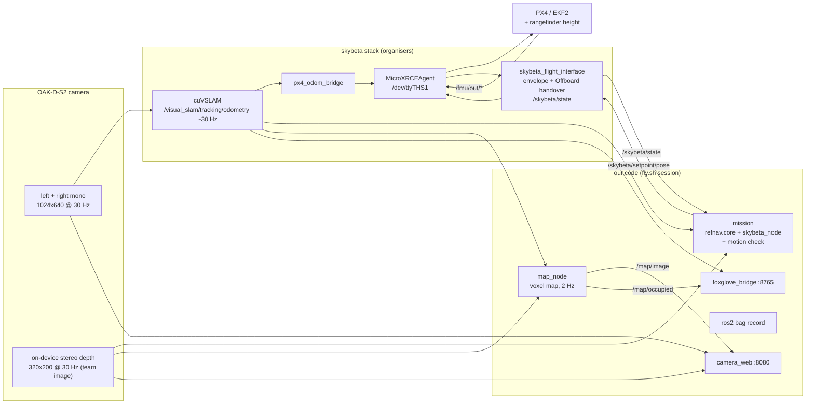

# How the drone system works (`main` branch)

Current state of the team's code (`main`) on the skybeta drone `skybeta-02` (Jetson Orin Nano, OAK-D-S2,
Pixhawk 6C on PX4 v1.16.2). For a quick start read `README.md`; this file is the full picture.

**Status:** everything below builds on the drone and passes its tests (56). Nothing has flown. The
first real runs are: bench with props off, then low and tethered.

> **Blocking issue, see `PICKUP.md`:** with the depth team image on (§5), VIO reaches PX4 ~290 ms
> late (organisers' baseline 60–70 ms). PX4 rejects it, has no local position, and the mission
> waits on "estimator unhealthy". Depth has to be fixed or turned off before flying.

---

## 1. Who owns what

| Layer | Owner | Where | We change it? |
|---|---|---|---|
| PX4 flight controller (EKF2, position control, failsafes) | organisers | Pixhawk | no |
| skybeta stack: OAK-D driver, cuVSLAM, VIO -> PX4 bridge, uXRCE agent, `skybeta_flight_interface` | organisers | Docker image `skybeta:0.3.2`, `~/skybeta` | no (one exception: the camera config, §5) |
| **Our code**: mission, motion check, map, camera page, flight session script | us | `~/team_ws/src/dronehacks` (this repo, branch `jetson` = `main`) | yes |

The contract between us and the organisers' stack is a handful of ROS topics. We **never** publish
on `/fmu/in/*`, never arm, never change PX4's mode and never land: the safety pilot does all of that
on RC, and `skybeta_flight_interface` turns our setpoints into PX4 commands inside a safety envelope
(altitude 0.3–3.0 m above the start, twist speed ≤ 1.5 m/s, **no horizontal geofence**).

## 2. Data flow



Position comes **only from VIO** (no GPS, no optical flow on any airframe). cuVSLAM runs as pure
stereo visual odometry: no IMU fusion, and its own SLAM/landmark map is switched off by the
organisers. "East/North" in `odom` are just the camera's axes at startup, and the origin is where
the drone sat when the stack started. Height in PX4 comes from the downward laser rangefinder.

## 3. Boot and a flight session

```mermaid
sequenceDiagram
  participant P as Pilot (RC)
  participant D as Drone boot
  participant F as fly.sh start
  participant M as mission
  D->>D: skybeta-stack.service starts agent, cuVSLAM, bridge
  D->>D: competitor window builds team code and idles (COMPETITOR_PKG=manual)
  Note over D: keep the drone still ~1 min: VIO origin + heading are set here
  F->>F: checks, team_build, opens tmux session "dronehacks"
  F->>M: mission + bag + foxglove + map + camera
  M->>M: waits: PX4 link, VIO tracking, live depth (3 s quiet each)
  M-->>P: READY: arm on Altitude, then switch to Position
  P->>P: arm, switch to Position
  Note over M: flight interface enters Offboard; mission takes off and flies
  M-->>P: MISSION ENDED / FREEZING: take over and land
  P->>P: throttle to centre, land, disarm
  F->>F: fly.sh stop (on the ground)
```

**At boot** only the organisers' stack runs. `/etc/skybeta/drone.env` has `COMPETITOR_PKG=manual`,
so the stack's `competitor` window builds our package and then waits at a shell instead of launching
anything. (Backup of the original file: `/etc/skybeta/drone.env.bak-before-dronehacks_nav`.)

**`scripts/fly.sh`** runs on the drone's host shell:

| Command | Does |
|---|---|
| `fly.sh start` | Refuses unless the stack runs, no session exists and the `competitor` window is idle (two flight interfaces would fight). Rebuilds `dronehacks_nav`, then opens a tmux session `dronehacks` in the container with five windows: `mission`, `bag`, `foxglove`, `map`, `camera` |
| `fly.sh status` | Window list and the mission's last lines |
| `fly.sh attach` | Watch live. `Ctrl-b n` next window, `Ctrl-b d` leave. **Never Ctrl-C the stack's `skybeta` session** |
| `fly.sh stop` | Ctrl-C to every window (closes the bag cleanly), then ends the session. **Only on the ground**: stopping in the air kills the flight interface and PX4 falls back to Position under the pilot |

## 4. The mission

`launch/mission.launch.py` starts `skybeta_flight_interface` (exactly as the organisers' example
does, `auto_offboard_on_arm:=true`) and our node `dronehacks_nav/skybeta_node.py`.

The flight decisions are made by **`refnav/core.py`**, the file the sim also flies
(`fly-sim-drone.sh --code main` on `victor/sim`, §10). `skybeta_node.py` is only
the adapter around it:

| refnav.core expects | skybeta_node gives it |
|---|---|
| PX4 local position, heading, attitude (NED/FRD) | cuVSLAM odometry converted ENU/FLU -> NED/FRD (`frames.py`) |
| armed, nav_state | `/skybeta/state` |
| landed | `/fmu/out/vehicle_land_detected` (read only) |
| estimator health (bool) | derived, fail-closed: odometry < 0.3 s old, cuVSLAM `vo_state == 1`, `/skybeta/state` fresh with `px4_link` and a local position |
| depth image + calibration | `/oak/stereo/image_raw` + TF `base_link <- oak_rgb_camera_optical_frame` |

| refnav.core asks for | skybeta_node does |
|---|---|
| a position setpoint | publishes it as ENU `/skybeta/setpoint/pose` |
| `offboard`, `arm` | nothing; logs `READY: pilot, arm on Altitude, then switch to Position` |
| `land` | nothing (skybeta has no land command); holds the last setpoint and logs `MISSION ENDED ... PILOT, TAKE OVER AND LAND` |

**Phases:** `wait` (all inputs healthy and 3 s of usable depth) -> `arm` (streams a hold so the
pilot's Position switch can hand over; gives up after `arm_wait_s` 120 s) -> `climb` to `height_m`
-> optional `hover` -> the route (`turn`, `check`, `go`, `hold` per leg) or `explore` -> `land`
(hold + pilot) -> `done`.

**Safety behaviour** (each is a unit test):
- Never translates without **observed** free space: depth must cover the corridor ahead; no return
  is unknown, not free. An obstacle closer than 0.9 m (in two consecutive frames) ends the route.
- Depth silent for 3 s, estimator unhealthy for 1 s, or PX4 position invalid: ends the flight.
- The pilot or a PX4 failsafe leaving Offboard is never fought: the mission stops ("yielded").
- **Motion check** (`dronehacks_nav/motion_check.py`, ours, drone only): while Offboard is ours and
  nothing is clamped, (a) a setpoint more than 0.3 m away for 3 s must move the drone 0.1 m toward
  it, and (b) VIO's height change must match PX4's rangefinder height within 0.3 m. On failure the
  node **freezes** at the drone's current VIO position, ends the mission and asks the pilot to take
  over. It does not use `/skybeta/hold`, which holds the last (unreached) setpoint and is cancelled
  by the next one.

**Current route:** `route.json` is the course: 14 legs from the launch mark through the maze, Gate A,
the tunnel, the chicane and the window to the pad, at **1.15 m** and 0.4 m/s. The waypoints are fitted to
the **2026-11-06 point scan** of the real course (`sim/scan/fit_route_to_scan.py` on `victor/sim-course-scan`),
not the CAD: in the real course m2, m3 and a1 sit 0.3-0.8 m from their CAD positions, and the CAD route
would hit walls on legs 3-7. The window opening is 0.88-1.52 m high (CAD: 0.30-1.22), hence 1.15 m.
**Take off on the launch mark facing the course's +Y**: the route is in the takeoff frame, so a heading
error rotates all of it.

Its params turn on three refnav options (all off by default): `slow_m` (the carrot slows near an obstacle
and never enters `stop_m`), `blocked_wait_s` (hold up to 4 s for an obstacle to clear before ending), and
`clear_past_leg_m` (a wall just past a corner waypoint is planned geometry; the nearest one is 0.34 m past
its waypoint). `corridor_half_m` 0.30 and `stop_m` 0.45 are sized for the Sky Beta (props reach ~0.29 m
from its centre); every leg's side clearance is >= 0.33 m, so side walls stay outside the watched corridor.

**Check on site before flying the route** (the scan cannot tell these apart):
1. A thin panel ~0.38 m wide, 0.2-1.8 m tall, about 0.25 m south of the launch mark (barrier_1 placed
   further north than the CAD?). Within prop reach of a straight climb from the mark.
2. Something small (~16 cm) in the middle of the window opening at ~1.1 m: tape, a crossbar or scan
   noise. If real, the mission holds and lands at the window. If not, add it to `EXCLUDE` in the script.
3. A person-shaped column in the maze at about (-1.6, 2.4) in course coordinates was left out as
   someone standing in the course during the scan. If it is a fixed object, the north maze corridor is
   too narrow for the drone.
4. c2b (a chicane wall) is not in the scan; the route still avoids its CAD position.

For a first flight use a plain hover: `{"route": [], "params": {"explore": false, "height_m": 1.0, "hover_s": 5.0}}`.

`/refnav/status` (JSON, 2 Hz) reports the phase, why it is waiting, depth age/coverage, rejects,
`motion_check` and `frozen_enu`.

## 5. Depth (the one change to the organisers' stack)

The organisers ship the OAK with depth off; refnav.core will not fly without depth. Their camera
config is baked into their image, so we use their supported **team image** mechanism:

- `skybeta_overrides/oakd_vslam.yaml`: their file with `i_pipeline_type: depth` and a `stereo:`
  block. Depth is decimated 2x **on the camera** (320x200, ~10 MB/s), because the USB link already
  carries ~118 of ~143 MB/s for the two eyes cuVSLAM uses.
- `skybeta_overrides/Dockerfile`: copies that file over theirs. On the drone `~/team_ws/Dockerfile`
  is a symlink to it and `~/team_ws/.dockerignore` sends only that folder to the build.
- `~/skybeta/host/run.sh build` builds `skybeta-team:0.3.2`; the stack uses it automatically.
  **Rebuild after every organiser update**, or the stack falls back to the stock image (no depth).
- Undo: `rm ~/team_ws/Dockerfile && docker rm -f skybeta-stack` (on the ground, drone still).

**This change breaks VIO latency.** Frame rates looked fine right after it (depth 30 Hz, odometry
28–30 Hz), but the organisers' latency probe shows the camera driver leg at p50 277 ms instead of
36.5 ms, and the full chain at 290 ms instead of 60–70 ms. That is too late for PX4, which then has
no local position. Measurements, cause and fixes: `PICKUP.md`. Other caveats: the depth is labelled
with the centre camera's frame but computed in a stereo camera's (up to ~3.75 cm sideways), and the
organisers have not been asked yet.

## 6. Map

`dronehacks_nav/mapping.py` (pure) + `dronehacks_nav/map_node.py` (ROS):

- 3D log-odds occupancy grid, 10 cm voxels, 20 x 20 x 4 m around the start. A depth ray marks its
  return cell occupied and the cells it crossed free; no return is no evidence. A moved obstacle
  clears after ~3 clear views.
- Each depth frame is paired with the odometry pose at its stamp (within 50 ms) and the static
  camera TF.
- Compute budget: newest frame only, integrated at 2 Hz with every 8th pixel (~1000 rays, tested
  under 50 ms), products published at 1 Hz.
- Outputs: `/map/occupied` (PointCloud2 in `odom`, for Foxglove) and `/map/image` (top-down slice
  0.3–2.0 m, north up: grey unknown, light free, red occupied, green cross start, yellow arrow
  drone, green trail).
- The map is a consumer only: nothing feeds it back into VIO or PX4. **The mission does not use
  it yet.**

VIO drift smears the map (doubled walls); fly slowly over texture.

## 7. Watching and recording

| What | How |
|---|---|
| Camera, depth, map | browser: `http://skybeta-02.local:8080/` (`camera_web.py`; MJPEG, ≤ 10 fps, encoded only while someone watches; `/stats.json` has rates, resolution, centre depth). Anyone on the same WiFi can open it |
| Pose, path, map cloud, state | Foxglove: on the laptop `ssh -N -L 8765:localhost:8765 dronehacks@skybeta-02.local` (silent while open), then `ws://localhost:8765`. Fixed frame `odom` |
| Recording | `~/team_ws/bags/<date-time>/` (mcap): odometry, VIO status, IMU, depth + info, `/skybeta/*`, `/refnav/status`, PX4 in/out, TF, logs. The map is not recorded; it can be rebuilt from depth + odometry |
| The stack itself | `docker exec -it skybeta-stack bash`, then `ros2 topic list`, `ros2 topic echo /skybeta/state`. Read a stack window without attaching: `docker exec skybeta-stack tmux capture-pane -p -t skybeta:slam` |

## 8. Settings

`config/drone.yaml` (ROS parameters of the mission node) and `route.json` (route and refnav
parameters). Main knobs:

| Parameter | Value | Meaning |
|---|---|---|
| `depth_topic` | `/oak/stereo/image_raw` | depth source |
| `depth_stride`, `depth_border_px`, `min_obstacle_px` | 4, 6, 75 | refnav's 1280x800 defaults scaled to 320x200 |
| `arm_wait_s` | 120 | time the pilot has after `READY` |
| `wait_s` | 600 | give up if never ready |
| `motion_check`, `motion_err_m`, `motion_window_s`, `motion_min_progress_m`, `motion_z_mismatch_m` | true, 0.3, 3.0, 0.1, 0.3 | the motion check |
| `height_m`, `speed_mps`, `stop_m`, `explore`, `hover_s` (refnav, in `route.json` params) | 1.2, 0.6, 0.9, true, 0 | mission shape |

The envelope (`max_altitude_m` 3.0, `min_altitude_m` 0.3, `max_speed_mps` 1.5) is a launch
argument; tighten it there, do not loosen it without asking the organisers.

## 9. Repository layout (`main`)

| Path | Role |
|---|---|
| `refnav/core.py`, `refnav/depth.py` | mission logic and depth geometry, identical to `main` |
| `dronehacks_nav/skybeta_node.py` | mission node: skybeta topics <-> refnav.core, motion check, freeze |
| `dronehacks_nav/frames.py` | ENU/FLU <-> NED/FRD |
| `dronehacks_nav/motion_check.py` | commanded motion vs odometry, VIO vs rangefinder |
| `dronehacks_nav/mapping.py`, `map_node.py` | voxel map and its node |
| `dronehacks_nav/camera_web.py` | camera/depth/map web page |
| `launch/mission.launch.py`, `config/drone.yaml`, `route.json` | what runs and with which settings |
| `scripts/fly.sh` | the flight session |
| `skybeta_overrides/` | team image: depth-enabled camera config |
| `package.xml`, `setup.py`, `setup.cfg`, `resource/` | the repo root is the ROS 2 package `dronehacks_nav` |
| `tests/` | `python3 -m pytest -q tests` (no ROS needed) |
| `shared-context/` | team agent context, merged from `main` |

On the drone, `~/team_ws/build`, `install` and `log` are colcon output. Their symlinks point at
`/root/team_ws/...` and only resolve inside the container; that is expected.

## 10. Git, testing in the sim, deploying

| Branch | Holds |
|---|---|
| `main` | **what the drone flies** (this tree). All mission work lands here |
| `victor/sim` | the Gazebo/PX4 sim and its tools. No drone code of its own |
| `jetson` | old name of `main`, kept equal to it (the drone's checkout is on `jetson`) |

**Testing a change in the sim, then flying it.** The sim does not keep a copy of the mission: it
flies this branch's code on the drone's own stack (skybeta flight interface, PX4 v1.16.2 SITL with
the drone's parameters, the same `mission.launch.py`). From a `victor/sim` checkout:

```sh
./fly-sim-drone.sh --code main            # or a feature branch / commit
```

So what passes in the sim is the same commit that goes to the drone; nothing is ported by hand.
`controllers/` on `victor/sim` is a scratchpad for trying algorithms on the sim's own runner;
an idea that works there is rewritten into `refnav/core.py` here and tested with the line above.
The sim's VIO is Gazebo's true pose (no drift, no latency), so a sim pass is necessary, not
sufficient.

**Deploying:** commit on `main`, fast-forward `jetson` (`git branch -f jetson main`, or
`git merge --ff-only main` in a `jetson` checkout), then `git push drone jetson`. The `drone`
remote is `dronehacks@skybeta-02.local:team_ws/src/dronehacks`; the drone's checkout updates in
place (`receive.denyCurrentBranch updateInstead`) and builds on the next `fly.sh start`. The drone
cannot `git pull`: the GitHub repo is private and the drone has no credentials.

## 11. Known gaps

- **VIO latency with depth on is ~290 ms; PX4 has no local position** (`PICKUP.md`, the next thing to fix).
- The camera page subscribes to the GPU converter's `/oak/left/image_mono` and slows that chain while open (`PICKUP.md` §2.6).
- Nothing has flown; the arm -> Position -> Offboard handover is untested on this airframe.
- Depth override not yet cleared with the organisers (§5).
- The yaw offset between VIO and PX4 is unmeasured (`odom_to_ned_yaw_offset_rad`, organisers' guide §1).
- The mission does not plan with the map yet.
- The drone's password has been shared in chat: move to SSH keys and change it.
